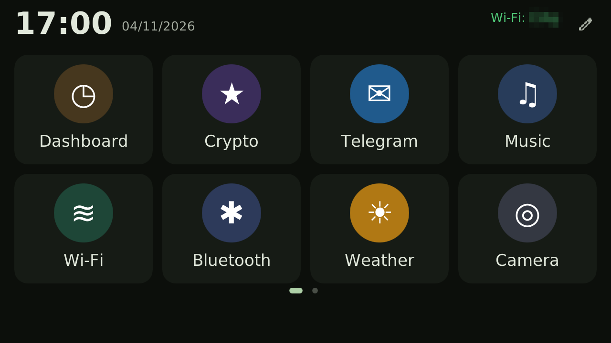
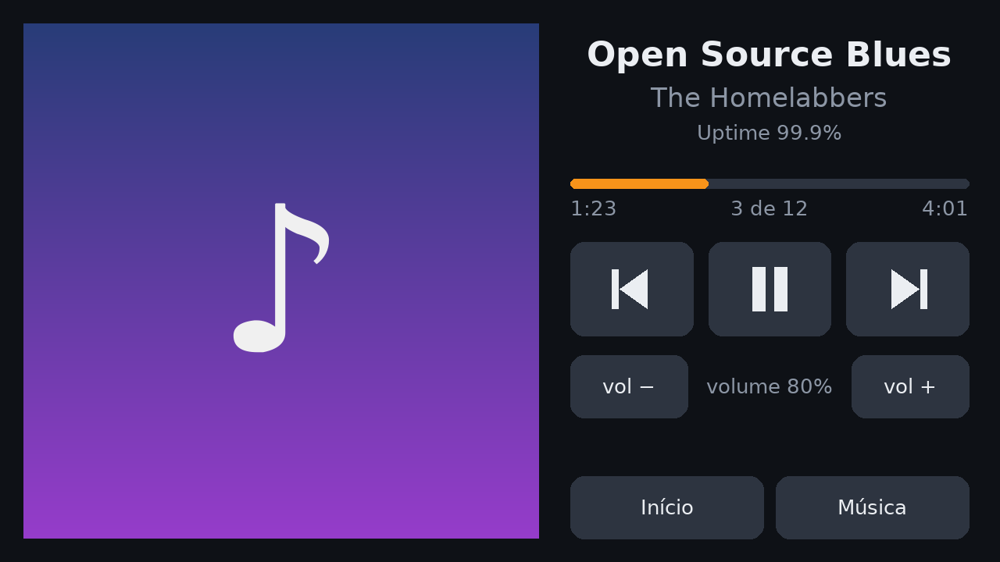
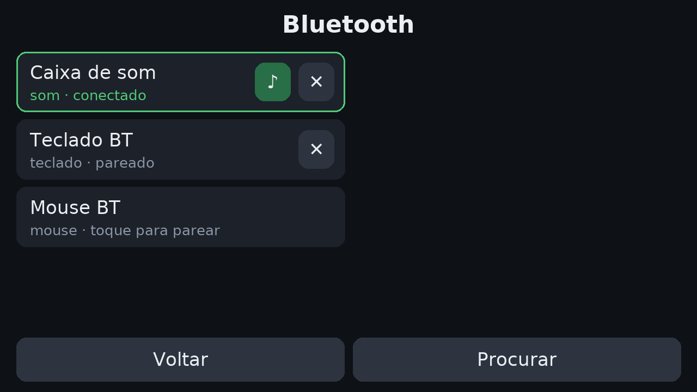

# Revive

**Give old phones a second life as useful homelab devices.**

Revive turns an old Android phone into a small Linux appliance for your home: a
jukebox for your self-hosted music, a Bitcoin ticker, a Bluetooth hub for speakers,
keyboards and mice — and, soon, a notification panel. It runs on top of
[postmarketOS](https://postmarketos.org) (Alpine Linux) and draws its own touch
interface straight to the framebuffer, so it needs no desktop, no GPU and very
little RAM.



| Now playing (Navidrome) | Bluetooth |
|---|---|
|  |  |

## Features

- **Touch UI in landscape** that rotates with the accelerometer, with an on-screen
  keyboard. USB/Bluetooth keyboards and mice also work (the mouse shows a pointer).
- **Wi-Fi setup** from the screen: scan, pick a network, type the password.
- **Bluetooth**: scan, pair, connect and forget devices from the screen. Keyboard
  pairing codes are shown on screen. Speakers play over A2DP (bluez-alsa) and
  reconnect automatically.
- **Music jukebox** for [Navidrome](https://www.navidrome.org) (any Subsonic API
  server): artists A–Z, recent/most played/random albums, random songs, playlists,
  search, cover art, seek, volume and scrobbling. Playback runs in a background
  `mpv`, so music keeps playing if the UI restarts. Uses your LAN address at home
  and a public one when away.
- **Bitcoin price** (BRL/USD, 24 h change) on the home screen.
- **Persistent logs** that survive hard freezes (kernel log and a health line per
  minute), which makes porting new devices much easier.

Planned: notification panel (ntfy / Home Assistant / MQTT), GPU-accelerated display
via a proper panel driver, more devices.

## Supported devices

| Device | Status | Notes |
|---|---|---|
| [Motorola Moto G 2013 (falcon)](devices/motorola-falcon/README.md) | Working | Wi-Fi, touch, Bluetooth, modem, GPS, sensors. No cameras. |

Adding a device means getting postmarketOS running on it and, if needed, a folder in
`devices/` with its quirks (see the falcon one as an example).

## Install

On a phone already running postmarketOS (OpenRC), as root:

```sh
git clone https://github.com/siriani/revive-phone
cd revive-phone
./install.sh --device motorola-falcon   # or without --device on other phones
reboot
```

Configuration lives in `/etc/revive/`:

| File | What |
|---|---|
| `navidrome.conf` | Navidrome URLs and account (see `config/navidrome.conf.example`, `chmod 600`) |
| `wpa_supplicant.conf` | Wi-Fi networks (the UI adds new ones by itself) |
| `wifi-no-ht` | present on devices whose Wi-Fi firmware crashes with 802.11n |

Services (OpenRC): `revive-ui`, `revive-bt`, `revive-mpv`, `revive-health`.
Logs: `/var/log/revive-*.log`.

## How it works

```
revive-ui (Python + Pillow) ──▶ /dev/fb0 (rotated to landscape)
    │  evdev: touch, keyboards, mice (hot-plug)
    ├─ wpa_cli ──▶ wpa_supplicant
    ├─ FIFO/JSON ──▶ revive-bt (D-Bus) ──▶ BlueZ + bluez-alsa
    └─ JSON IPC ──▶ revive-mpv (mpv --idle) ◀── Navidrome (Subsonic API)
```

The UI only redraws what changed where it can (button highlight on tap, progress
bar while playing) and boosts the CPU frequency while you touch the screen, because
a full-screen update costs ~100 ms on a 2013 phone.

## Contributing

Issues and pull requests are welcome — especially new devices and translations.
The UI text is currently in Brazilian Portuguese.

## License

MIT (see [LICENSE](LICENSE)). Bundled: Slint Material components (`ui-slint/material`, MIT, © SixtyFPS GmbH, metrics scaled 1.5x), Material Symbols icons (`ui-slint/ui/icones`, Apache-2.0, © Google), DejaVu fonts (`ui-slint/ui/fontes`, free license). Kernel patches in `devices/*/patches` are GPL-2.0, like
the Linux kernel; device tree files keep their original license header.

---

## Em português

**Revive dá uma segunda vida a celulares antigos como aparelhos úteis no homelab:**
jukebox do seu Navidrome, cotação do Bitcoin, central Bluetooth para caixas de som,
teclados e mouses e, em breve, painel de notificações. Roda sobre o postmarketOS e
desenha a própria interface na tela (sem desktop e sem GPU), em paisagem, girando
pelo acelerômetro.

Instalação: num celular com postmarketOS, como root, `./install.sh --device
motorola-falcon` e reiniciar. As configurações ficam em `/etc/revive/` e os logs em
`/var/log/revive-*.log`. O guia completo do Moto G (desbloqueio, gravação, kernel)
está em [devices/motorola-falcon](devices/motorola-falcon/README.md).
