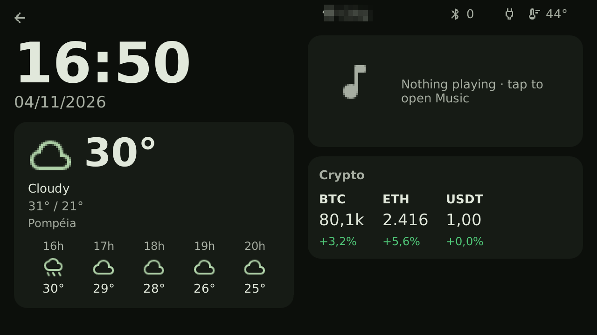
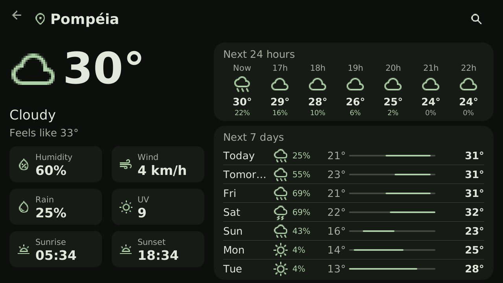
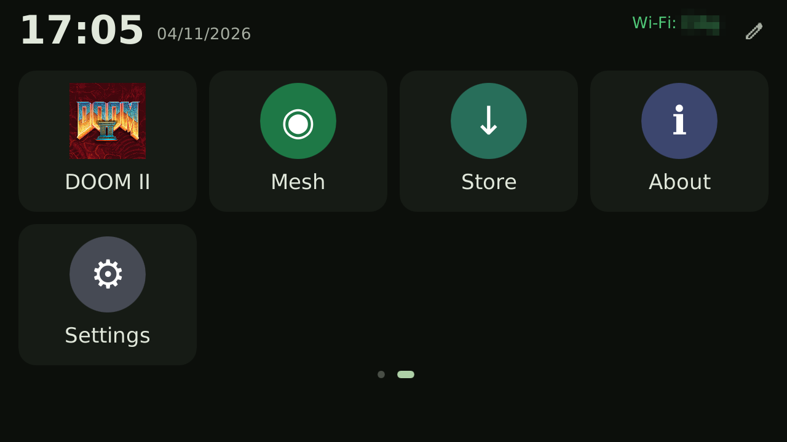
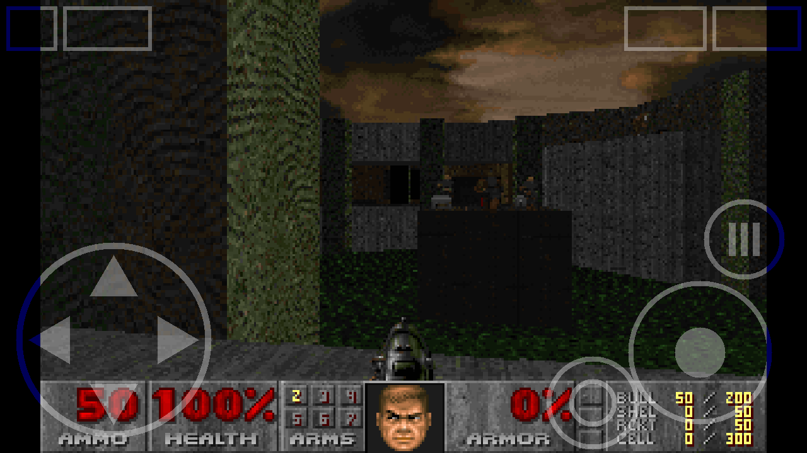
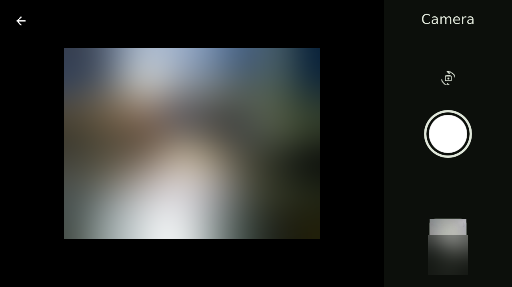
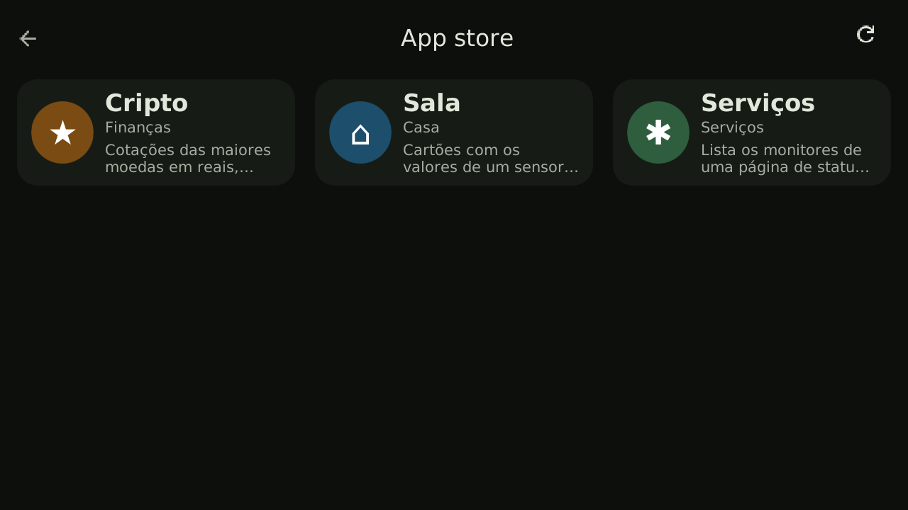
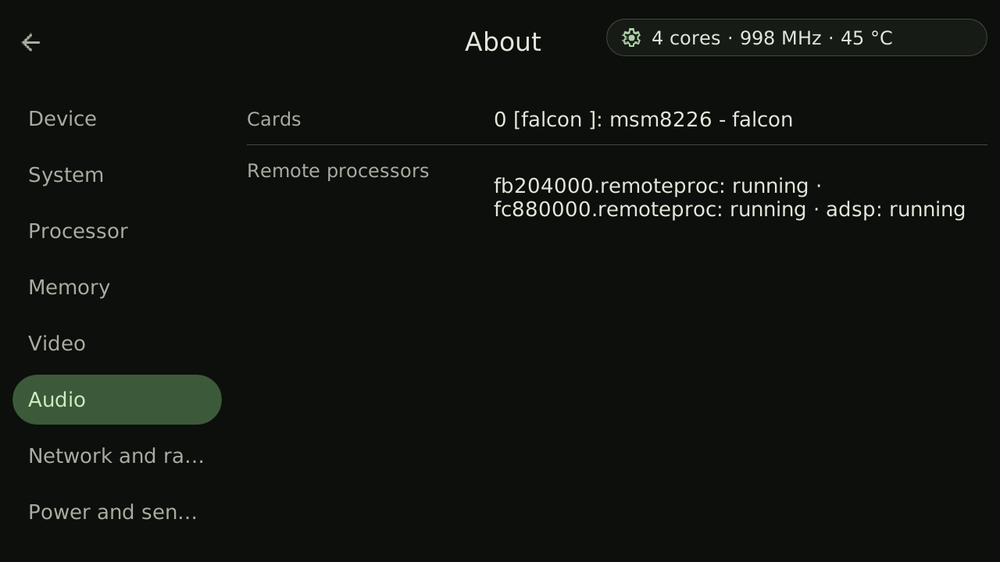
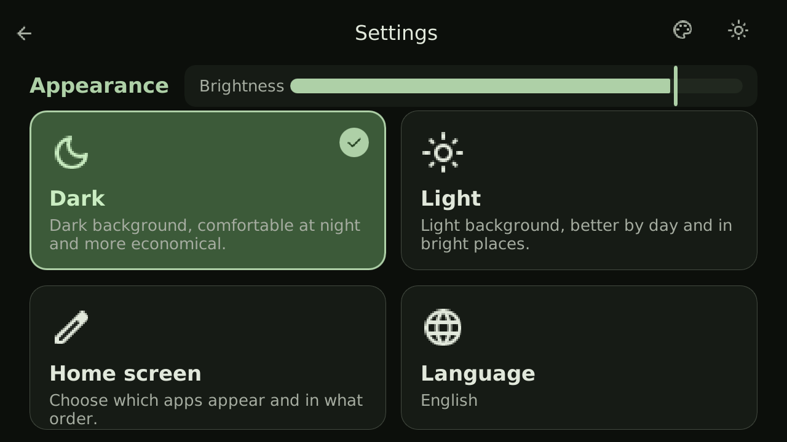

# Revive

**Give old phones a second life as useful homelab devices.**

Revive turns an old Android phone into a small Linux appliance for your home: a
jukebox for your self-hosted music, a weather and crypto dashboard, a Meshtastic
messenger, a camera, a Bluetooth hub — and even a DOOM II machine. It runs on top of
[postmarketOS](https://postmarketos.org) (Alpine Linux) with a mainline kernel and
draws its own touch interface ([Slint](https://slint.dev), Rust) straight to the
framebuffer: no desktop, no compositor, very little RAM.


| Dashboard | Weather |
|---|---|
|  |  |
| **More apps** | **DOOM II** |
|  |  |
| **Camera** (front/rear switch) | **App store** |
|  |  |
| **About the system** | **Settings** |
|  |  |

## Features

- **Touch UI in landscape** (Material 3 look, dark/light themes) that rotates with the
  accelerometer, with an on-screen keyboard. USB/Bluetooth keyboards and mice also work.
  **English, Portuguese and Spanish.**
- **Home screen** with pages; choose which apps are shown and in what order.
- **Dashboard**: clock, weather, what is playing and crypto prices at a glance.
- **Music** for [Navidrome](https://www.navidrome.org) (any Subsonic server): artists,
  albums, playlists, search, favorites, queue, shuffle/repeat. Playback runs in a
  background `mpv`, so music keeps playing if the UI restarts.
- **Sound** through the **built-in loudspeaker** or a Bluetooth speaker (A2DP); the
  output switches automatically when a speaker connects. Hardware volume keys work.
- **Camera** with front/rear switch, preview and gallery.
- **Weather** (next 24 h and 7 days), **Crypto** prices, **Telegram** reader.
- **Meshtastic**: nearby nodes and text messages over Bluetooth LE or Wi-Fi.
- **DOOM II** as a native app (doomgeneric) with touch controls — bring your own WAD.
- **App store** based on GitHub repositories (manifest apps).
- **Wi-Fi** and **Bluetooth** setup from the screen.
- **About the system**: SoC, CPU clock and temperature, memory, display/GPU/audio
  drivers, remote processors.
- **Brightness** control and **persistent logs** that survive hard freezes, which makes
  porting new devices much easier.

## Supported devices

| Device | Status | Notes |
|---|---|---|
| [Motorola Moto G 2013 (falcon)](devices/motorola-falcon/README.md) | Working | Wi-Fi, touch, Bluetooth, modem, GPS, sensors, display (DRM), backlight, GPU, CPU up to 1.19 GHz, both cameras, loudspeaker. Headphone jack and microphone not yet. |

Adding a device means getting postmarketOS running on it and, if needed, a folder in
`devices/` with its quirks (see the falcon one as an example).

## Install

On a phone already running postmarketOS (OpenRC), as root:

```sh
git clone https://github.com/siriani/revive-phone
cd revive-phone
./install.sh --device motorola-falcon   # or without --device on other phones
reboot
```

Configuration lives in `/etc/revive/`:

| File | What |
|---|---|
| `navidrome.conf` | Navidrome URLs and account (see `config/navidrome.conf.example`, `chmod 600`) |
| `mesh.conf` | Meshtastic: `ble=` through the local Bluetooth bridge or `host=` for Wi-Fi direct; optional `pin=` |
| `wpa_supplicant.conf` | Wi-Fi networks (the UI adds new ones by itself) |
| `wifi-no-ht` | present on devices whose Wi-Fi firmware crashes with 802.11n |

Services (OpenRC): `revive-ui`, `revive-bt`, `revive-mesh-ble`, `revive-mpv`,
`revive-health`, `revive-video` (on the Moto G it loads the display, CPU, camera and
audio drivers 15 s after boot, so a driver problem never blocks the boot).
Logs: `/var/log/revive-*.log`.

## Meshtastic

The UI shows nearby Meshtastic nodes and exchanges text messages. It speaks the
Meshtastic stream protocol over TCP port 4403 and reads `/etc/revive/mesh.conf`.
There are two ways to connect:

### Bluetooth (default, through the `revive-mesh-ble` bridge)

`revive-mesh-ble` connects to the node over Bluetooth LE and listens on
`127.0.0.1:4403`, so the UI keeps using the same TCP protocol:

```ini
# /etc/revive/mesh.conf
ble=AA:BB:CC:DD:EE:FF   # node address; remove this line to scan for 15 s
pin=123456              # optional; Meshtastic's default PIN
host=127.0.0.1          # the UI connects to the local bridge
```

If `ble=` is absent, the service scans for 15 seconds for a device advertising the
Meshtastic GATT service, uses the first one and writes its address back to the file.
`host=` and `porta=` are ignored by the bridge (they are for the UI). When the node is
not found, the service exits and OpenRC starts it again after 60 seconds. If the BLE
link drops, it reconnects with a 5 s → 60 s backoff while the TCP server keeps
accepting clients; the UI receives packets again when the node comes back. One TCP
client is served at a time (a new connection closes the previous one).

Pairing: the Meshtastic PIN is `123456` by default. If BlueZ asks for it, the
`revive-bt` pairing agent returns `pin=` from `mesh.conf` (or `123456` when no PIN is
set) when the address matches `ble=`. If pairing still fails, pair once manually and
the bridge will only reconnect:

```sh
bluetoothctl
agent on
default-agent
pair AA:BB:CC:DD:EE:FF
trust AA:BB:CC:DD:EE:FF
```

### Wi-Fi (direct)

Point `host=` at the node and remove `ble=` so the UI talks to the node directly:

```ini
# /etc/revive/mesh.conf
host=192.168.1.50
# porta=4403
```

The node accepts only **one TCP client at a time**. Stop `revive-mesh-ble` (or do not
run both) before using the direct connection, and make sure no other phone or app is
connected to the node.

## How it works

```
revive-ui (Rust + Slint, software renderer) ──▶ /dev/fb0 (msm DRM, rotated to landscape)
    │  evdev: touch, volume keys, keyboards, mice (hot-plug)
    ├─ wpa_cli ──▶ wpa_supplicant
    ├─ FIFO/JSON ──▶ revive-bt (D-Bus) ──▶ BlueZ + bluez-alsa
    ├─ JSON IPC ──▶ revive-mpv (mpv --idle) ──▶ ALSA: loudspeaker or Bluetooth speaker
    ├─ V4L2 ──▶ CAMSS (front MT9M114 / rear AR0543)
    └─ TCP 4403 ──▶ revive-mesh-ble ──▶ Meshtastic node (BLE)
```

The UI renders off-screen and copies only the changed rectangles to the framebuffer,
so the camera preview and animations do not flicker on a 2013 phone.

## Contributing

Issues and pull requests are welcome — especially new devices and translations
(`ui-slint/lang/*/LC_MESSAGES/revive-ui.po`).

## License

MIT (see [LICENSE](LICENSE)). Bundled: Slint Material components (`ui-slint/material`, MIT, © SixtyFPS GmbH, metrics scaled 1.5x), Material Symbols icons (`ui-slint/ui/icones`, Apache-2.0, © Google), DejaVu fonts (`ui-slint/ui/fontes`, free license). The DOOM engine in `doom/engine` is [doomgeneric](https://github.com/ozkl/doomgeneric) (GPL-2.0); no game data is included — put your own `doom2.wad` in `/var/lib/revive/doom/` (Freedoom is used otherwise). Kernel patches in `devices/*/patches` are GPL-2.0, like
the Linux kernel; device tree files keep their original license header.

---

## Em português

**Revive dá uma segunda vida a celulares antigos como aparelhos úteis em casa:**
música do seu Navidrome, painel com clima e cripto, mensagens Meshtastic, câmera,
central Bluetooth e até DOOM II. Roda sobre o postmarketOS com kernel mainline e
desenha a própria interface (Slint, em Rust) direto na tela, em paisagem, girando pelo
acelerômetro. Interface em português, inglês e espanhol.

No Moto G (falcon) funcionam tela (DRM), GPU, CPU até 1,19 GHz, as duas câmeras e o
**alto-falante interno** (ADSP + codec WCD9302); os drivers entram 15 s depois do boot,
pelo serviço `revive-video`. Falta o fone de ouvido e o microfone.

Instalação: num celular com postmarketOS, como root, `./install.sh --device
motorola-falcon` e reiniciar. As configurações ficam em `/etc/revive/` e os logs em
`/var/log/revive-*.log`. O guia completo do Moto G (desbloqueio, gravação, kernel)
está em [devices/motorola-falcon](devices/motorola-falcon/README.md).
